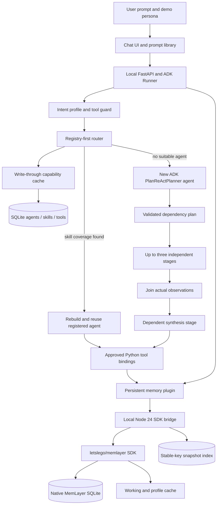
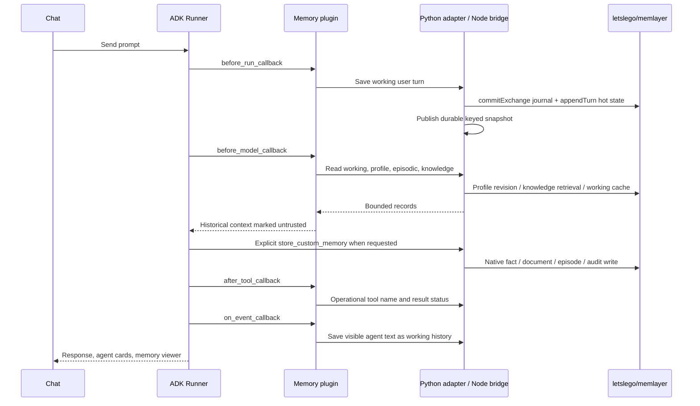

# Architecture and execution paths

This repository runs Google ADK Python with Claude, a registry-first router, and the
[letslego/memlayer](https://github.com/letslego/memlayer) TypeScript SDK. The dependency is
pinned in `memlayer-dependency.json`; its private source is cloned locally and not copied into this repo.

## Registry consistency and agent creation

The registry commits metadata to SQLite before publishing cache entries. A durable version counter
invalidates caches in other instances. Agent records are scoped by application, user and session;
verified skill descriptions and approved tool metadata are shared. Stored JSON never contains executable
code. Runtime functions come from a code-side allowlist and are rechecked against the current policy.

The root looks up all three registries. A registered agent with the requested skill coverage is reused,
including a Plan/ReAct agent. Otherwise the router registers a new `LlmAgent` using ADK's
`PlanReActPlanner`. Creation changes the goal, selected skills and permitted tool set; it does not invent
an executable connector. Missing integrations are reported as gaps.

`execute_goal_plan` validates stage IDs and dependencies before execution. Ready stages run through
`asyncio.gather` with isolated invocation/session state, at most three at a time. Selected output
collections merge after the batch joins. Dependent stages receive actual previous outputs. Failed stages
stop dependent work. Delegation is capped at 12 calls and eight session roles; the server configures
24 model calls per invocation (nested invocations have their own ceiling).

## Memory reads and writes

Operational memory is never loaded by `before_model_callback`. Model reasoning marked as thought is
excluded from conversation persistence. Tool audit records omit tool arguments and credentials.

## Persistence boundaries

Native profile facts, documents, episodes, audits and journal records live in
`.adk/letslego-memlayer.sqlite`. The bridge keeps `.adk/memlayer-bridge-index.sqlite` for stable custom
keys, latest versions and durable session snapshots. It writes native MemLayer first, then publishes
the snapshot. Those two stores do not form one distributed transaction: a snapshot-write failure can
leave an orphaned native record. Native episodic/knowledge/audit writes are append-only; replacing a
custom key updates the bridge's current snapshot and can leave prior native versions.

`appendTurn` alone is transient. The bridge also commits each working item to MemLayer's journal and
persists its keyed snapshot, so our session view survives restart and hot-cache TTL. This is an adapter
for keyed items, not a claim that MemLayer's generic append API is durable or that every saved item is
a complete real user/assistant exchange. The journal's question carries the key envelope and its answer
carries the saved text. The SDK indexing worker runs in the bridge process.

Profile reads use MemLayer's revision-aware `getProfile`. Knowledge queries use its tenant-filtered
HNSW/BM25 retrieval and explicit user ACLs; empty-query memory browsing uses the snapshot index.
Episodic and operational custom-item browsing also uses the keyed snapshot index after native SDK writes.
The SDK's default hash embedder works offline; it is not a learned semantic embedding model.

Only profile-fact deletion is supported by the upstream public SDK. The bridge returns an explicit
conflict for deletion of working, knowledge, episodic or operational items rather than pretending the
native records were removed. A retention/deletion implementation is needed for those layers.

## Enterprise boundary

The persona selector and localhost API are demonstrations, not SSO or tenant authorization. The bridge
binds an application to a deterministic tenant and restricts knowledge documents to the supplied user;
production must derive both from authenticated server context. SQLite is single-host storage. Add
SSO, authorization, encryption/secret management, retention, operational access controls and deployment
hardening before enterprise exposure. Memory is historical data, never policy, permissions or verified
financial evidence.
